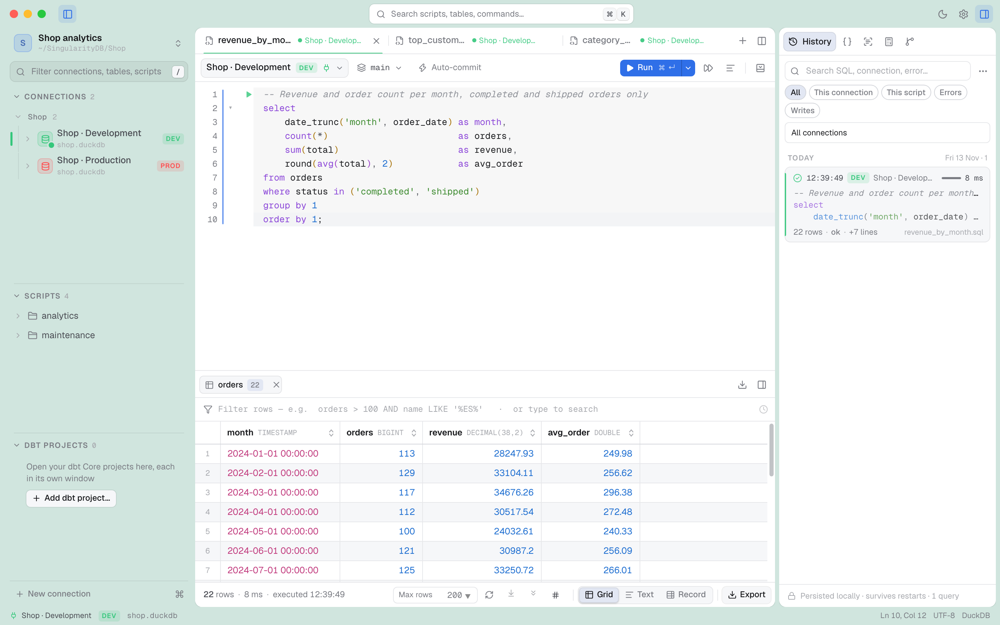
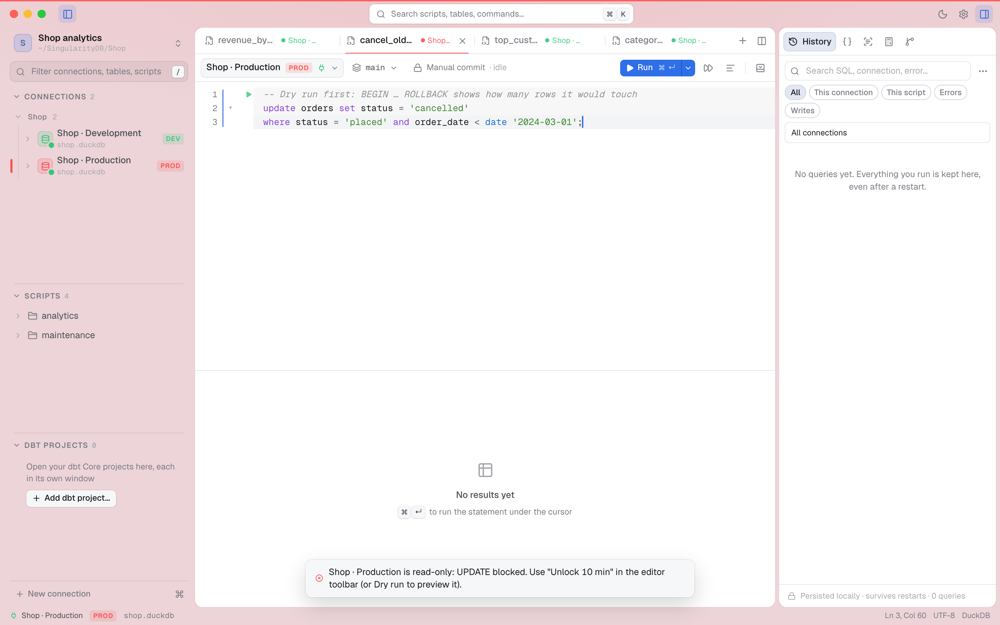
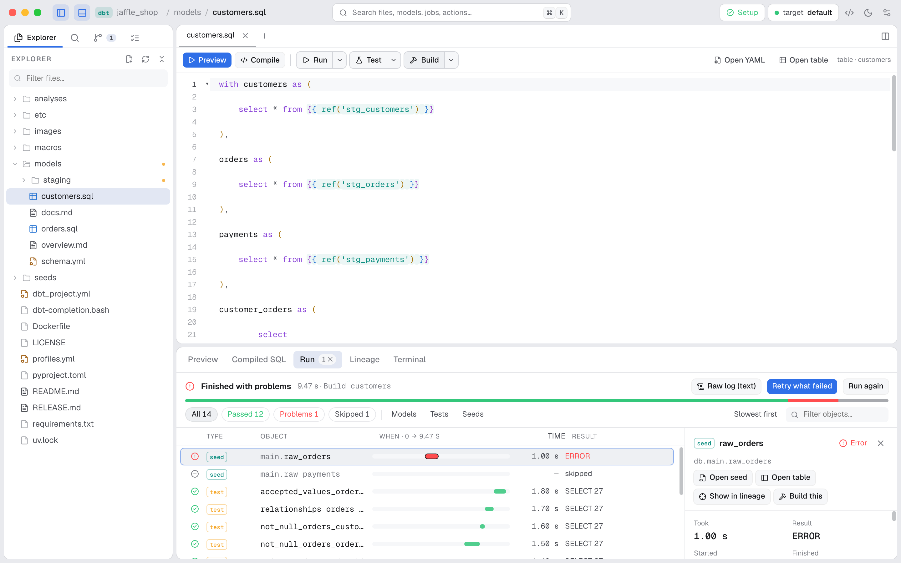

  

<h1 align="center">SingularityDB</h1>

<b>A SQL client that keeps SQL, dbt and Git in one place.</b> 
PostgreSQL first. Also DuckDB, SQLite and Oracle Fusion (OTBI). macOS and Windows.

  <a href="https://github.com/marctalaban/SingularityDB-releases/releases/latest"><b>⬇ Download the latest release</b></a>

  <picture>
    <source media="(prefers-color-scheme: dark)" srcset="assets/hero-dark.png" />
    
  </picture>

> **Status: early (0.4.x).** Used every day by its author, but young: expect rough edges. All screenshots use invented data.

## Install

| | Download | First time you open it |
|---|---|---|
| **macOS** (Apple silicon) | The `.dmg` from the [latest release](https://github.com/marctalaban/SingularityDB-releases/releases/latest). Drag SingularityDB to Applications. | The app isn't notarised by Apple yet: macOS blocks it once. Go to *System Settings → Privacy & Security* and click **Open Anyway**. |
| **Windows** (x64) | The `…_x64-setup.exe` from the [latest release](https://github.com/marctalaban/SingularityDB-releases/releases/latest). | The installer isn't code-signed yet: on the SmartScreen warning, click **More info → Run anyway**. |

**Updates** arrive by themselves: the app checks this repository and shows an **Update** button when a new version is out.

## Why

Day-to-day data work jumps between a SQL client, a terminal for dbt, and Git. SingularityDB puts the three in one window, with
the habits of DBeaver (profiles, connections, `.sql` scripts, variables, environments) and a few guard rails that are easy to
forget when you are tired and the connection says PROD.

## What makes it different

- **SQL, dbt and Git in one app.** dbt projects get their own window with a live status for every model and test, lineage down to the column, saved jobs and Git.
- **Guard rails you cannot forget.** Production is read-only until you unlock it for ten minutes, enforced by the server; writes can be dry-run inside `BEGIN … ROLLBACK`; an `UPDATE` with no `WHERE` asks first.
- **Share connections without sharing secrets.** Save them to the profile's folder (never passwords) and load them on another machine through a review where *you* tick what changes.
- **Move data between engines from the export dialog.** PostgreSQL to DuckDB to try a model, a result straight into another database, or a file (CSV, real `.xlsx`, JSON, SQL…).
- **No starting over.** Import a DBeaver project's connections, or open its folder in place: your scripts stay where they are.
- **Local first.** No account, no telemetry, no cloud service. The only network traffic of its own is the update check.

  <picture>
    <source media="(prefers-color-scheme: dark)" srcset="assets/prod-guardrails-dark.png" />
    
  </picture>

  <picture>
    <source media="(prefers-color-scheme: dark)" srcset="assets/dbt-run-dark.png" />
    
  </picture>
   The dbt screenshot shows the public <a href="https://github.com/dbt-labs/jaffle_shop_duckdb">jaffle_shop</a> sample project with a simulated run.

## Engines

| Engine | What works |
|---|---|
| **PostgreSQL** | Everything: SSH tunnel, SSL, manual commit, DBA tools (sessions, locks, sizes, top queries) |
| **DuckDB** | Query, browse, edit, export |
| **SQLite** | Query, browse, edit, export |
| **Oracle Fusion (OTBI)** | Read-only SQL, through a BI Publisher report you create once |

## About this repository

It only holds the release files and the update manifests the app reads; the source code isn't published yet.
Found a bug or have an idea? [Open an issue](https://github.com/marctalaban/SingularityDB-releases/issues).

Made by [Marc Talabán](https://marctalaban.github.io/).
